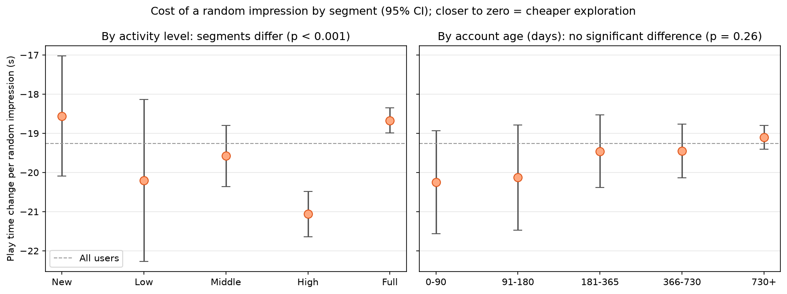

# The Cost of Exploration in Short-Video Recommendation

**How much engagement does a platform give up when it shows a random video instead of a recommended one, and for which users is that cost lowest?**

Short-video platforms reserve part of every feed for *exploration*: content the recommender is not confident about, shown to collect feedback, surface new creators, and avoid feedback loops. This project uses a randomized exposure log from Kuaishou to measure what that exploration traffic costs in engagement, and where it is cheapest to place.

## Key results

- **A random impression loses about 80% of a recommended impression's engagement.** Within the same user, a random video gets 80.5% fewer long views, 19.3 fewer seconds of play time (−78.6%), 68.6% fewer clicks, and 77.5% fewer likes. Hate rate rises by 84%.
- **Each percentage point of exploration traffic costs about 0.8% of total watch time**, assuming per-impression effects with no spillover (0.01 × 78.6%).
- **The naive comparison understates the cost.** Random impressions come disproportionately from users with higher baseline engagement (pre-period play time +13.2%), so a simple difference in means is biased toward zero (−71.6% vs. −78.6% for play time).
- **Relative cost is nearly uniform across users, but absolute cost is not.** Every segment loses roughly 74–81% of engagement. In absolute terms, exploration is cheapest for full-active users (−18.7s per random impression; new users are similar but less precisely estimated) and most expensive for high-active users (−21.1s).

## Data

[KuaiRand-Pure](https://kuairand.com/) (Gao et al., CIKM 2022): interaction logs from the Kuaishou short-video app, in which a small share of recommended videos were replaced at random with videos from a candidate pool.

| Log | Period | Role |
|---|---|---|
| Random exposure | 2022-04-22 to 05-08 | Treatment |
| Standard recommendation | 2022-04-22 to 05-08 | Control |
| Standard recommendation | 2022-04-08 to 04-21 | Pre-period covariates |
| User features | — | Segments |

The analysis is restricted to **tab 1**, which holds 99.3% of random exposures and has a single definition of `is_click` (the field means *click* in one UI and *valid play* in another). This leaves **1,401,538 impressions from 27,024 users** (1,178,025 random, 223,513 recommended).

## Approach

**1. Sanity checks** (`00_data_overview`). Confirmed clean group separation and identical date ranges, then found that the tab mix differed sharply between groups. Restricting to tab 1 increased the measured cost by 3–4 points, showing that mixing tabs dilutes the control mean.

**2. Treatment effect** (`01_treatment_effect`). Randomization is at the impression level, so the same user appears in both groups (90.7% of users do). All standard errors are **cluster-robust by user**. Three estimators:

| Estimator | Purpose |
|---|---|
| Difference in means | Baseline |
| CUPED (pre-period metric as covariate) | Variance reduction |
| **Within-user (user fixed effects)** | Compares random vs. recommended impressions for the same user, removing differences in user mix. **Primary estimate.** |

A covariate balance check showed that treatment impressions come from more engaged users. CUPED's point estimates shifted in the direction of that imbalance for every metric, including the one metric (like rate) where the imbalance runs the other way, which independently confirms the bias in the naive estimate.

**3. Heterogeneous effects** (`02_heterogeneous_effects`). Split the within-user effect by activity level and account age, fitting all segments in one regression and testing equality with a Wald test. Small raw segments (one segment had a single user, which makes the clustered SE degenerate) were pooled into five groups per dimension.

## Results

### Main effect (tab 1, within-user)

| Metric | Recommended mean | Effect of random exposure | Relative change |
|---|---|---|---|
| Long view rate | 0.352 | −0.283 | **−80.5%** |
| Play time (s) | 24.5 | −19.3 | **−78.6%** |
| Click rate | 0.498 | −0.342 | **−68.6%** |
| Like rate | 0.020 | −0.016 | **−77.5%** |
| Hate rate | 0.00082 | +0.00069 | **+84.2%** |

All positive-engagement effects have |t| > 30; the hate-rate increase has t ≈ 4.9. Losses are largest on deep engagement (long view, like) and smallest on clicks: random videos still get opened, but rarely watched through.

### By user segment



- **Activity level:** absolute effects differ significantly (p < 0.001), mostly because baseline engagement differs. Full-active users have the lowest precisely estimated cost (−18.7s, below the −19.3s average), and at 66% of the user base they can absorb most exploration traffic. New users show a similar point estimate (−18.6s) but with a much wider interval. High-active users are the most expensive (−21.1s); shifting one exploration impression from high- to full-active users saves about 2.4s of play time (≈11% of the cost).
- **Account age:** play-time cost does not differ by tenure (p = 0.26). New accounts (0–90 days) lose the same ~79% as accounts older than two years, so there is no clear evidence that random content is cheaper during cold start.
- **Hate rate:** segment differences are not robust after correcting for six joint tests (p = 0.06 and 0.037 vs. a Bonferroni threshold of ≈0.008).

## Product implications

1. **Budget exploration explicitly.** At roughly 0.8% of watch time per percentage point of traffic, exploration share is a measurable cost that should be weighed against its long-run benefits.
2. **Place exploration on full-active users first.** They have the lowest per-impression cost and the largest volume.
3. **Track hate rate as a guardrail.** Random content raises negative feedback by 84%, a cost that watch-time metrics alone do not capture.

## Limitations

- **Short-term only.** The analysis measures the immediate engagement cost of exploration, not its long-run value (better recommendations, creator discovery, retention), which is the reason platforms explore in the first place.
- **Uniform random exposure.** The treatment draws from the whole candidate pool. Production exploration usually draws from more relevant candidates, so these estimates are an upper bound on the cost of a well-designed exploration policy.
- **Subset effects.** KuaiRand-Pure keeps control rows only for candidate-pool videos, which likely causes the user-mix imbalance between groups. The within-user estimator addresses this.
- **Descriptive segments.** Segments are not randomized, so differences between segments are descriptive; the effect within each segment is causal.
- **Weighting.** The within-user estimator weights users by the within-user variance of their treatment share, so it is not identical to a simple average over impressions.

## Repository structure

```
kuairand-experiment-analysis/
├── data/                          # not tracked; see "Reproduce"
│   ├── raw/KuaiRand-Pure/
│   └── processed/                 # Parquet files created by 00
├── figures/
│   └── hte_play_time_lift.png
├── src/
│   ├── 00_data_overview.ipynb     # load data, sanity checks, raw comparison
│   ├── 01_treatment_effect.ipynb  # DM, CUPED, within-user estimates
│   └── 02_heterogeneous_effects.ipynb
└── README.md
```

## Reproduce

```bash
mkdir -p data/raw && cd data/raw
curl -L -O https://zenodo.org/records/10439422/files/KuaiRand-Pure.tar.gz
md5 KuaiRand-Pure.tar.gz        # 0820331067a3784d9691136f772b35a7
tar -xzf KuaiRand-Pure.tar.gz && rm KuaiRand-Pure.tar.gz
```

Run the notebooks in `src/` in order: `00` → `01` → `02`. `00` converts the logs to Parquet; the later notebooks read from those files.

**Stack:** Python 3.11, DuckDB, pandas, statsmodels, matplotlib.

## Citation

Gao, C., Li, S., Zhang, Y., Chen, J., Li, B., Lei, W., Jiang, P., & He, X. (2022). KuaiRand: An Unbiased Sequential Recommendation Dataset with Randomly Exposed Videos. *Proceedings of the 31st ACM International Conference on Information and Knowledge Management (CIKM '22)*, 3953–3957.
